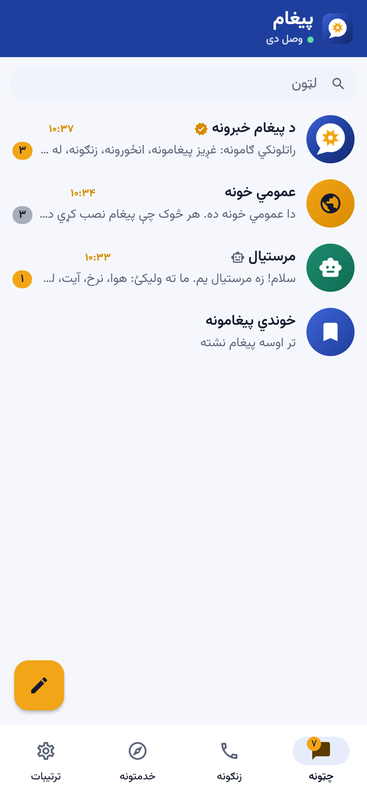
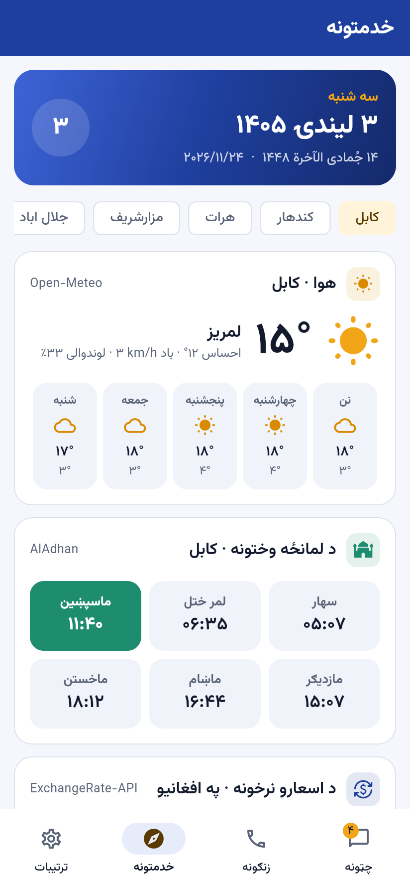
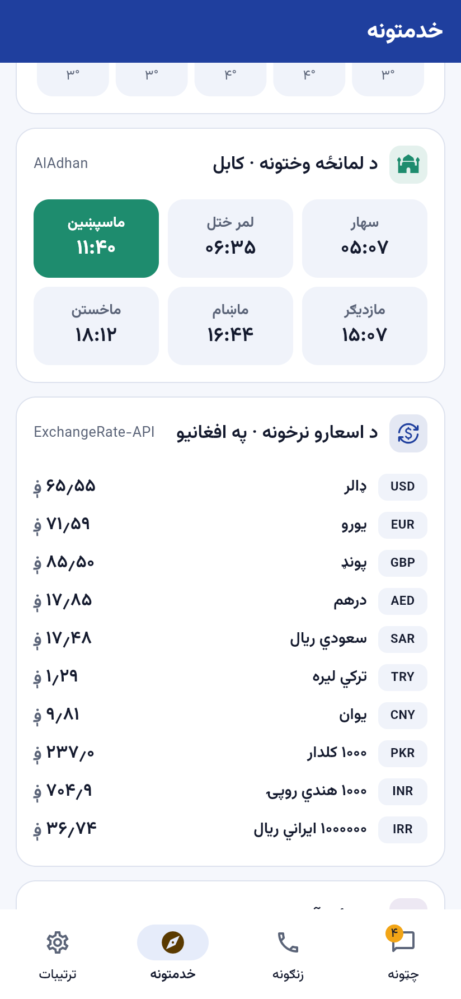
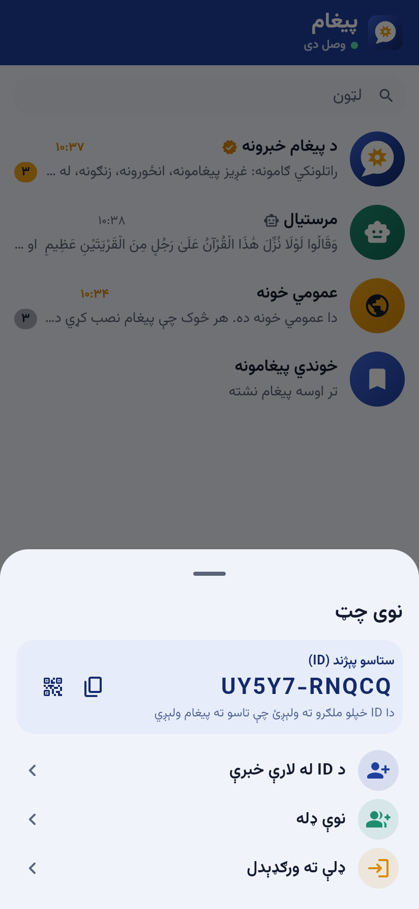
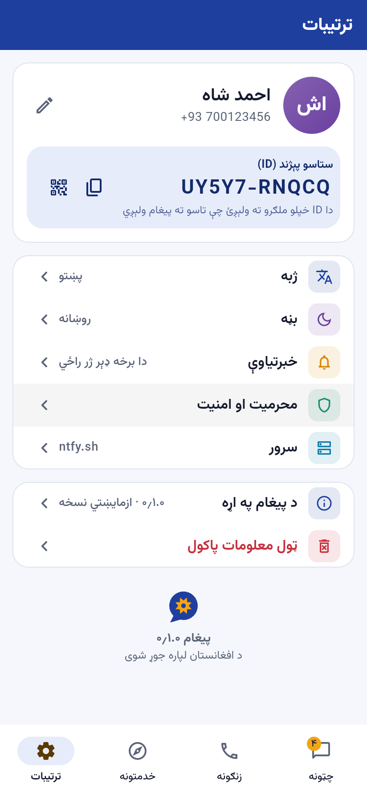
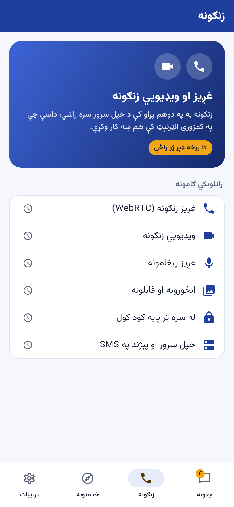
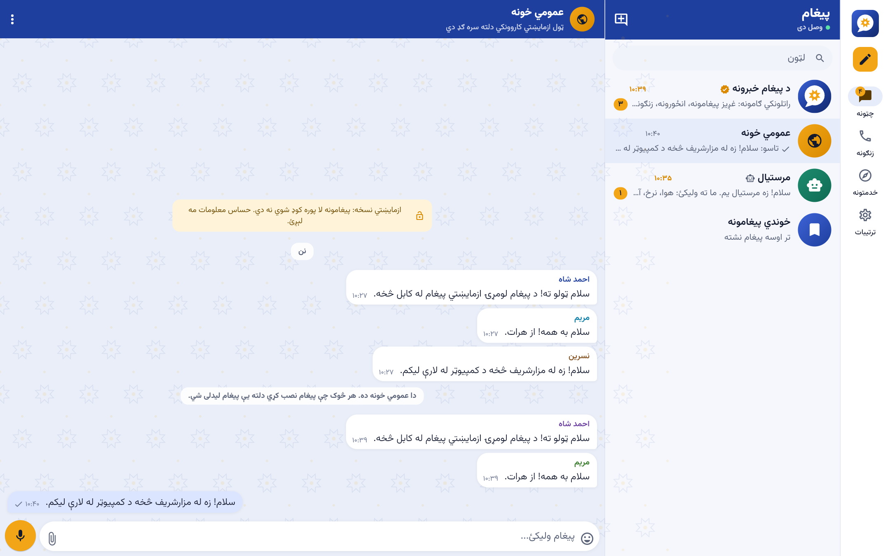
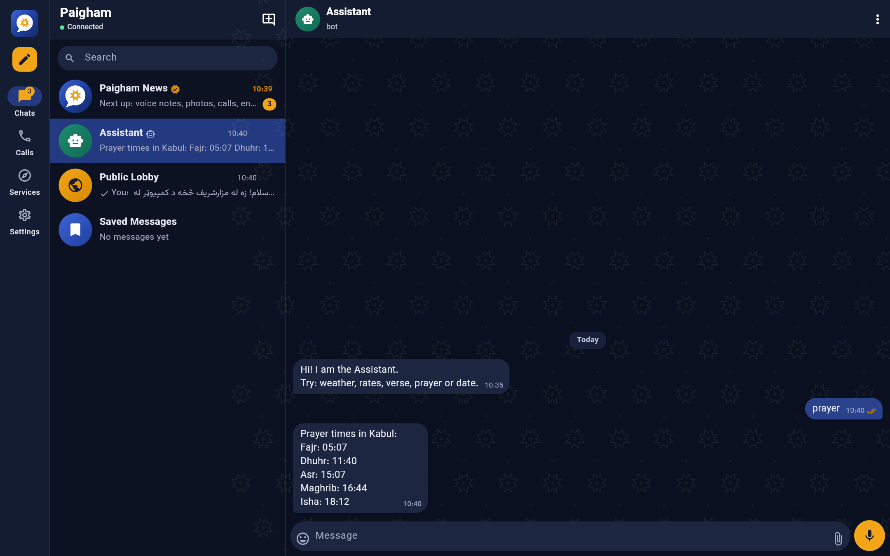

<p align="center">
  
</p>

<h1 align="center">پیغام · Paigham</h1>
<p align="center"><b>د افغانانو خپل پیغام رسان</b> — The Afghan messenger</p>
<p align="center">Android · iPhone · Windows · macOS · Linux · Web — له یوه کوډ څخه / from one codebase</p>

---

<div dir="rtl">

## پیغام څه دی؟

پیغام د واټساپ او ټلګرام په څېر یو پیغام رسان دی چې د افغانانو لپاره جوړېږي: په **پښتو، دری او انګلیسي** ژبو، د افغاني لمریز کلیز سره، او داسې ډیزاین شوی چې په کمزوري انټرنېټ کې هم کار وکړي.

دا **لومړۍ ازمایښتي نسخه (0.1.0)** ده. اوس وړیا خدمتونه کاروو؛ کله چې پروژه وده وکړي، خپل سرور اخلو او یوازې د سرور پته بدلوو.

### په دې نسخه کې څه شته

- یو بل ته پیغامونه د **ID** له لارې (د لېږل شوي ✓، رسېدلي ✓✓، او لوستل شوي ✓✓ نښې)
- **ډلې** جوړول او د بلنې کوډ سره ورګډېدل
- **عمومي خونه**: ټول کاروونکي پکې سره خبرې کولی شي
- **مرستیال روبوټ**: هوا، د اسعارو نرخ، آیت، د لمانځه وخت، نېټه
- **خدمتونه**: د افغانستان د ۱۰ ښارونو هوا، د لمانځه وختونه، په افغانیو د اسعارو نرخ، د ورځې آیت (پښتو/دری ژباړه)
- لمریز، قمري او میلادي نېټه
- روښانه او تیاره بڼه، QR کوډ، لټون، ټاکل شوي (پن) چټونه
- په موبایل کې لاندې مېنو، په کمپیوټر او وېب کې د ټلګرام ډیسکټاپ په څېر دوه برخیز ډیزاین

### ډاونلوډ

هر ځل چې کوډ GitHub ته ځي، **GitHub Actions** (د `.github/workflows/build.yml` فایل) په خپله ټول فایلونه جوړوي او د **Releases** برخې ته یې اچوي:
`.apk` (اندروید)، `.ipa` (آیفون)، `.zip` (وینډوز او مک)، `.tar.gz` (لینکس)، او وېب.

> ⚠️ دا ازمایښتي نسخه ده: پیغامونه لا له سره تر پایه کوډ شوي (encrypted) نه دي. حساس معلومات مه لېږئ.

</div>

---

## Screenshots

| Onboarding (Pashto) | Chats | Real chat, read receipts | Same chat on the other phone (Dari) |
|---|---|---|---|
|  |  |  |  |

| Assistant bot | Verse with Pashto translation | Services | Rates in Afghani |
|---|---|---|---|
|  |  |  |  |

| Dari onboarding | New chat / your ID | Settings | Calls (planned) |
|---|---|---|---|
|  |  |  |  |

**Desktop / web (two-pane layout)**




---

## One codebase, every platform

The app is written once in **Dart** with **Flutter**. Each platform gets a thin native host that Flutter generates and builds:

| Platform | Native host language | Build output |
|---|---|---|
| Android | **Kotlin** (`app/android/.../MainActivity.kt`) | `.apk`, `.aab` |
| iPhone / iPad | **Swift** (`app/ios/Runner/AppDelegate.swift`) | `.ipa` |
| Windows | **C++** (`app/windows/runner/`) | `Paigham.exe` |
| macOS | **Swift** (`app/macos/Runner/`) | `Paigham.app` |
| Linux | **C++** (`app/linux/runner/`) | `paigham` binary |
| Web | JavaScript / WebAssembly | static site |

All screens, logic and translations live in `app/lib/` and are shared by every platform.

## Free services used (prototype phase)

| Service | Used for | Listed on [public-apis](https://github.com/public-apis/public-apis) |
|---|---|---|
| [ntfy.sh](https://ntfy.sh) | Real-time message relay (open source, self-hostable) | – |
| [Open-Meteo](https://open-meteo.com) | Weather for 10 Afghan cities | ✓ Weather |
| [ExchangeRate-API](https://www.exchangerate-api.com) (open endpoint) | Rates in Afghani | ✓ Currency Exchange |
| [AlQuran Cloud](https://alquran.cloud/api) | Verse of the day, Pashto/Dari/English translations | ✓ Books |
| [AlAdhan](https://aladhan.com/prayer-times-api) | Prayer times (Hanafi, Karachi method) | – |
| [Vazirmatn](https://github.com/rastikerdar/vazirmatn) | Font with full Pashto alphabet (OFL) | – |

None of them need an account or API key. Each is wrapped in one file (`app/lib/services/`) so it can be replaced by our own backend later.

## How messaging works today

- Every user gets a random 10-character ID (e.g. `K7M2Q-9XA3F`); share it to be reachable.
- Each user listens on one inbox topic on ntfy.sh over a WebSocket; groups use one topic each.
- Delivery and read receipts are small messages sent back to the sender's inbox.
- ntfy keeps messages for about 12 hours, so a phone that was offline catches up when it reconnects.
- **Moving to our own server:** ntfy is open source. Install it on our server and change the address in *Settings → Server*. No app update needed.

See [docs/ARCHITECTURE.md](docs/ARCHITECTURE.md) for details and the roadmap, and [docs/BRAND.md](docs/BRAND.md) for the name, colours and logo.

## Run it yourself

```bash
# Flutter 3.47.9 (stable): https://docs.flutter.dev/get-started/install
cd app
flutter pub get
flutter run -d chrome      # web
flutter run                # a connected Android/iPhone, or the desktop
flutter test               # unit tests
```

## Builds (GitHub Actions)

`.github/workflows/build.yml` runs on every push and:
1. analyzes and tests the code,
2. builds Android, iOS, Windows, macOS, Linux and Web in parallel,
3. publishes a GitHub Release (`build-N`) with all the files. Pushing a tag like `v0.1.0` makes an official release.

Optional settings:
- **Same Android signature for every build** (so updates install over the old app): add repository secrets `ANDROID_KEYSTORE_BASE64`, `ANDROID_KEYSTORE_PASSWORD`, `ANDROID_KEY_ALIAS`, `ANDROID_KEY_PASSWORD`. Without them each build is signed with a temporary debug key, so uninstall the old build before installing a new one.
- **Web version on GitHub Pages**: Settings → Pages → Source *GitHub Actions*, then add the repository variable `DEPLOY_PAGES = true`.
- **iPhone**: the `.ipa` is unsigned. Installing on real iPhones needs an Apple Developer account (signing + TestFlight).
