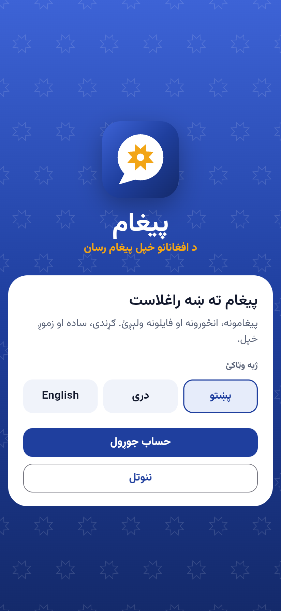
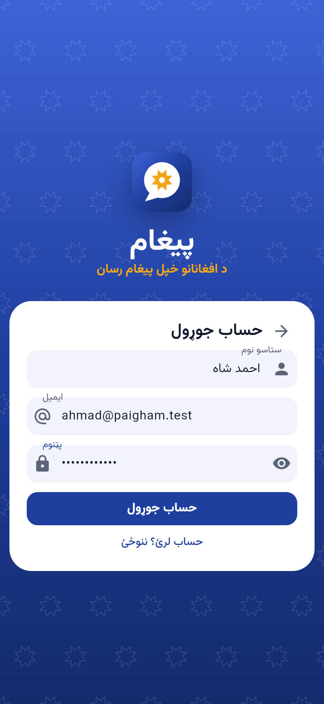
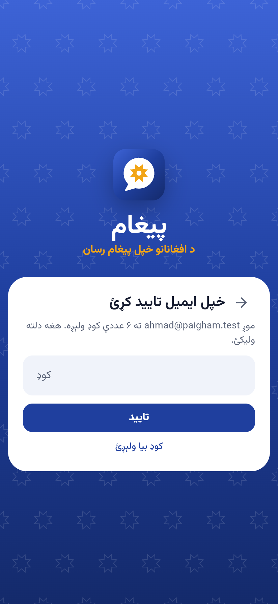
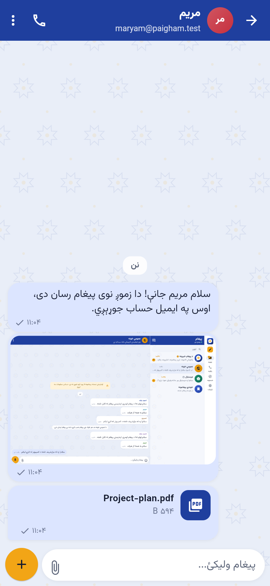
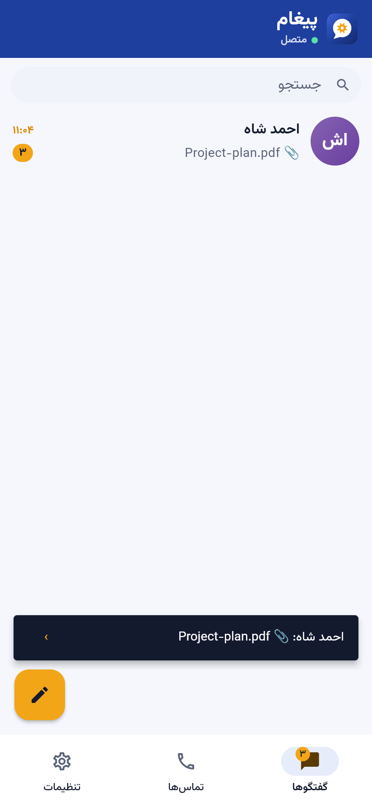
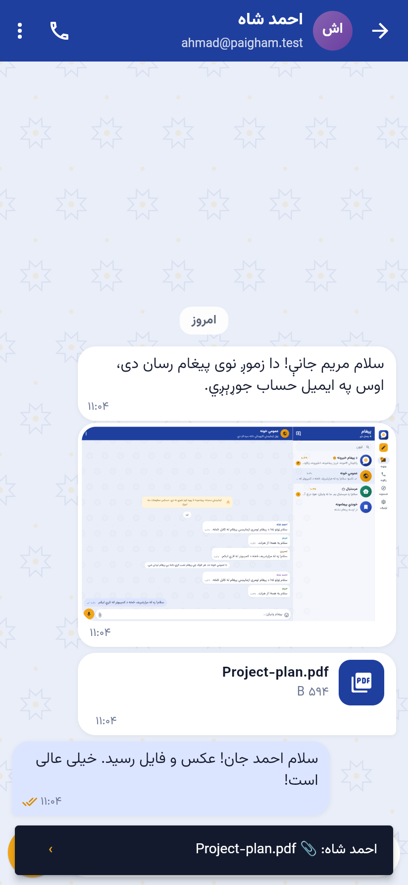
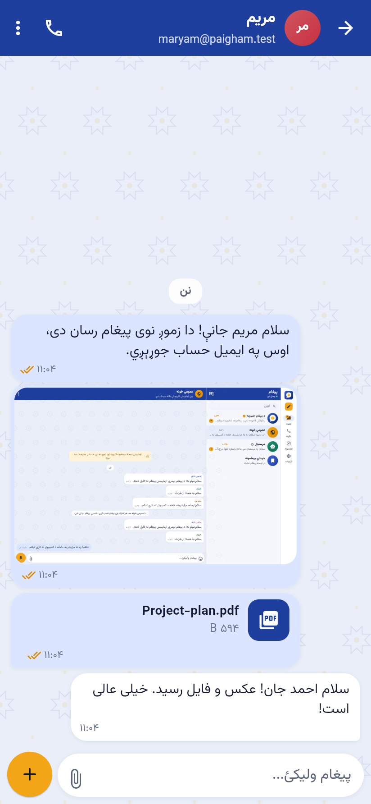
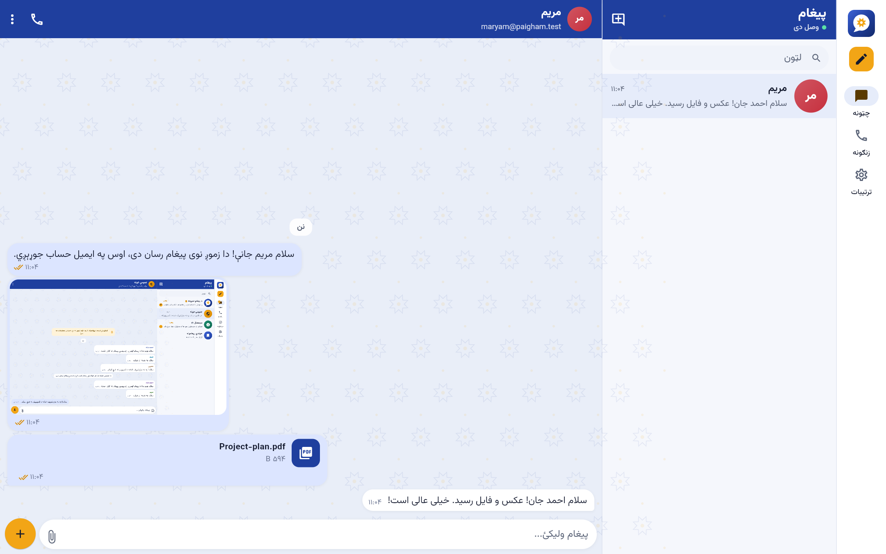

<p align="center"></p>

<h1 align="center">پیغام · Paigham</h1>
<p align="center"><b>د افغانانو خپل پیغام رسان</b> — The Afghan messenger</p>
<p align="center">Android · iPhone · Windows · macOS · Linux · Web — له یوه کوډ څخه / one codebase</p>

---

<div dir="rtl">

## پیغام څه کوي؟

- **په ایمیل حساب جوړول:** ایمیل او پټنوم، بیا ایمیل ته راغلی ۶ عددي کوډ. ننوتل، وتل، او د هېر شوي پټنوم بدلول.
- **خلک موندل** د ایمیل یا @کارن‌نوم له لارې، او ورسره چټ پیل کول.
- **پیغامونه، انځورونه او فایلونه** (PDF، Word، Excel، ZIP، غږ، ویډیو… تر ۵۰ MB).
- **ډلې** جوړول او غړي ورزیاتول.
- **ژر رسېدل** (realtime)، او ✓ لېږل شوی / ✓✓ لوستل شوی نښې.
- په هره وسیله ننوځئ، ټول پیغامونه مو هلته وي.
- پښتو، دری او انګلیسي؛ روښانه او تیاره بڼه؛ لمریز کلیز.
- امنیت: هر څوک یوازې خپل چټونه او فایلونه لیدلی شي (په سرور کې Row Level Security).

## سرور: Supabase (اوس وړیا، وروسته خپل سرور)

۱. په [supabase.com](https://supabase.com) کې وړیا حساب او نوې پروژه جوړه کړئ.
۲. د `backend/supabase/migrations/` فایل په **SQL Editor** کې ورکړئ او Run یې کړئ.
۳. په **Authentication → Email Templates** کې د `backend/supabase/templates/` متن ورکړئ (تر څو کوډ په ایمیل کې راشي).
۴. له **Project Settings → API** څخه `Project URL` او `anon/publishable key` واخلئ.
۵. په GitHub کې: **Settings → Secrets and variables → Actions → Variables** کې دا دوه ورزیات کړئ: `SUPABASE_URL` او `SUPABASE_ANON_KEY`. بیا هر نوی build په همدې سرور وصلېږي.

</div>

## Screenshots

| Welcome | Sign up | Email code | Find by email |
|---|---|---|---|
|  |  |  |  |

| Photo + PDF sent | Incoming (Dari) | Received, replied | Read ticks |
|---|---|---|---|
|  |  |  |  |

**Same account logged in on a computer — full history synced:**



## Architecture

| Part | Technology |
|---|---|
| App (all platforms) | Flutter / Dart — `app/` |
| Native hosts | Kotlin (Android), Swift (iOS/macOS), C++ (Windows/Linux) |
| Accounts | Supabase Auth: email + password, 6-digit email code, password reset |
| Database | Postgres with Row Level Security — `backend/supabase/migrations/` |
| Realtime | Supabase Realtime (new messages, read receipts) |
| Files | Supabase Storage, private bucket, 50 MB per file, short-lived signed links |
| Builds | GitHub Actions — `.github/workflows/build.yml` → Releases |

Supabase is open source. When we buy our own server we self-host the same stack and only change `SUPABASE_URL`.

**Free tier (enough for testing and early users):** 50,000 monthly users, 500 MB database, 1 GB files. Its built-in email sender is limited to a few emails per hour, so before launch connect a free SMTP provider (e.g. Brevo or Resend) under *Authentication → SMTP*.

## Run locally

```bash
# backend (needs Docker)
cd backend && npm install && npm start        # local Supabase; test emails at http://127.0.0.1:54324

# app
cd app
flutter run -d chrome \
  --dart-define=SUPABASE_URL=http://127.0.0.1:54321 \
  --dart-define=SUPABASE_ANON_KEY=<anon key printed by npm start>
flutter test
```

## Builds

Every push builds Android (APK/AAB), iOS (unsigned IPA), Windows, macOS, Linux and Web and publishes them as a GitHub Release. Optional secrets for a fixed Android signature: `ANDROID_KEYSTORE_BASE64`, `ANDROID_KEYSTORE_PASSWORD`, `ANDROID_KEY_ALIAS`, `ANDROID_KEY_PASSWORD`.

See [docs/ARCHITECTURE.md](docs/ARCHITECTURE.md) and [docs/BRAND.md](docs/BRAND.md).
